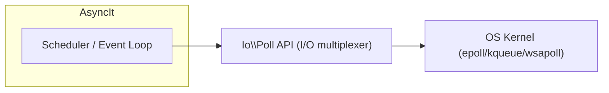

# PHP Polling API & AsyncIt (Async I/O) – Deep Research Report

## Executive Summary

The new PHP **Polling API** (Io\Poll) – introduced in PHP 8.6 – provides a unified, low-level I/O multiplexing primitive that bridges a long-standing gap for high-concurrency PHP. It exposes platform-native poll mechanisms (epoll on Linux, kqueue on BSD/Mac, event ports on Solaris, and WSAPoll on Windows) via a consistent API. This RFC, authored by Jakub Zelenka (FrankenPHP maintainer), was proposed in late 2025 and accepted by vote (PHP 8.6, May 2026). Its goal is to replace the old `stream_select()` approach (with its 1024-FD limit) and finally give PHP core and extensions access to scalable, edge-triggered I/O notification. For AsyncIt, this means a cross-platform polling backend is now available in core, eliminating the need for multiple PECL libs and allowing AsyncIt’s event loop to be built directly on native primitives.

Major async runtimes (Swoole/OpenSwoole, Swow, ReactPHP, Amp/Revolt, etc.) today use a variety of mechanisms to monitor I/O. For example, Swoole/OpenSwoole use the OS’s epoll/kqueue directly (via `epoll_wait` on Linux, `kqueue` on macOS), Swow – built on libuv – similarly leverages these mechanisms across platforms. ReactPHP’s loops can use libevent, libev or libuv extensions (supporting epoll/kqueue) or fall back to pure `stream_select`. Amp v3 and Revolt use fiber-based event loops (e.g. Revolt) with drivers for ext-ev/event/uv (epoll/kqueue) or select. In practice, Swoole’s and Swow’s coroutine engines internally turn blocking PHP I/O calls into nonblocking epoll waits, whereas ReactPHP/Amp use explicit nonblocking streams. The new Poll API sits beneath all this as the common native selector. In future, frameworks can replace their multiple backend implementations with Io\Poll – for example, Steve King notes that ReactPHP and Amp maintain parallel native loops only because PHP lacked a built-in polling primitive.

Below we document the Poll API’s design and timeline, survey each major runtime’s I/O polling, and compare their semantics (edge vs. level triggers, timeouts, handles, signals, etc.). We outline patterns for integrating the Poll API into **AsyncIt** (e.g. as the “poll provider” layer under the scheduler/event-loop, with runtime capability negotiation). Finally we list interoperability concerns and provide a capability matrix contrasting Poll API vs. each runtime, and show a recommended architecture diagram for AsyncIt including the Poll API.  

## 1. PHP Poll API – RFC and Status

The **PHP Polling API** was introduced via an RFC (v1.4) on April 25, 2026 by Jakub Zelenka. Its motivation is to give PHP core and extensions a *unified internal polling interface*, replacing `stream_select()`’s limitations and enabling modern I/O (epoll/kqueue, edge-triggering, timer support, etc.).  After discussion in PHP internals, the RFC entered voting on May 20, 2026 and passed overwhelmingly (33 yes, 1 no). The status is “Implemented” in PHP 8.6. 

In design, Io\Poll provides a `Context` object for a collection of watchers, each watching a `Handle` (an I/O resource) for events.  For example, one can create a context and do: `$ctx->add(StreamPollHandle($stream), [Event::Read, Event::Write])` to watch a stream.  The `Context::wait()` method then blocks (or waits with timeout) until events occur, returning an array of triggered `Watcher` instances. Notably, the API deliberately remains minimal – it does *not* implement timers or signal management (these stay in higher-level libraries) – it only provides polling. The backends supported include **epoll** (Linux), **kqueue** (macOS/BSD), **event ports** (Solaris/illumos), **WSAPoll** (Windows), and generic **poll** as fallback. The API auto-selects the best backend at runtime (developers rarely need to choose).  

A key design element is the `Io\Poll\Handle` abstraction: this is a marker interface implemented by PHP-internal classes (e.g. `StreamPollHandle`) to tie language resources to file descriptors. In the initial implementation only streams are covered (via `StreamPollHandle`), but the RFC notes future extensions (e.g. socket or cURL handles) can plug into this model. The RFC also adds an `Event` enum with flags including `Read`, `Write`, `EdgeTriggered`, `OneShot`, etc. Edge-triggered mode (only report state changes) and one-shot mode (remove watcher after event) are explicitly supported on backends that allow them (epoll and kqueue). Developers can check `Backend::supportsEdgeTriggering()` at runtime to detect if edge mode is available.  

In summary, PHP 8.6 now includes a standardized, efficient I/O polling primitive. The RFC explicitly targets internal use and performance (e.g. better signal handling on ZTS, improved PHP-FPM event loops), with a secondary benefit of a *userspace API replacement for stream_select()* for frameworks. As documented, this will enable projects like Amp and ReactPHP to “use a single, efficient backend instead of maintaining multiple backend implementations”. 

## 2. Poll API and PHP Internals Discussions

The Polling API was discussed on php.internals (now PHP Foundation Discourse).  Jakub Zelenka announced the draft in late 2025, and by March 2026 had refined it per feedback.  Key design points from discussions: the API was namespaced under `Io\Poll` (the final RFC uses `namespace Io\Poll`). Exceptions were refined (e.g. using `ValueError` for invalid streams), and helper methods like `getAvailableBackends()` and `supportsEdgeTriggering()` were added.  One commenter noted that all backends allow different event sets, but Jakub assured that all required events (read, write, error, hang-up) are monitored by default, regardless of requested flags.  Overall, the community feedback was incorporated into the final spec (see, for example, adding the `supportsEdgeTriggering()` method).  

According to the PHP.Watch summary, the RFC’s vote ran May 20–June 3 2026 (33 yes, 1 no, 4 abstain). At final publication (v1.4), the wiki shows **Status: Implemented**. This means by late 2026 developers can target Io\Poll in shipping PHP releases (or polyfill on earlier versions with external libs).

## 3. Polling in Major PHP Async Runtimes

PHP has several major async/coroutine/event-loop libraries. We briefly survey how each handles I/O polling:

- **Swoole / OpenSwoole** – Swoole is a popular PHP extension that provides coroutine-based concurrency. It implements its own event loop at the C level.  On Linux it uses **epoll** internally, and on macOS/BSD **kqueue** (OpenSwoole docs explicitly state using `epoll_wait` on Linux, falling back to kqueue on Mac). Swoole lets you register sockets for read/write callbacks (`Swoole\Event::add()`) and then calls `Swoole\Event::wait()` to block until events occur. Swoole also includes separate timer APIs (`Swoole\Timer`) and signal support. In effect, Swoole’s runtime is a *different PHP execution model*: it hijacks PHP’s usual blocking calls so that, for example, `sleep()` or `fwrite()` can suspend a coroutine and yield to epoll behind the scenes. (As Steve King notes, Swoole “hooks into PHP streams” and uses epoll to resume coroutines.) OpenSwoole (an open-source fork) has an event loop module that explicitly says it is a “file-based event loop” over `epoll_wait`, integrating streams, sockets, etc.

- **Swow** – Swow is a C extension (by the AnswerDev project) offering fibers and async I/O. It targets cross-platform support (Linux, Windows, macOS) using a small C core and most logic in PHP. Swow relies on **libuv** (as indicated by its docs mentioning common OS and “same as libuv”), which itself uses epoll/kqueue/IOCP under the hood. Thus Swow’s event loop likewise uses epoll on Linux and kqueue on BSD/Mac (and IOCP on Windows via libuv). Swow provides fiber-based coroutines and non-blocking APIs for sockets, timers, etc. It behaves similarly to Swoole in spirit, but is more PHP-centric in design. (Official Swow docs and code imply a poll-based reactor, though we found no standalone doc like OpenSwoole’s. The GitHub readme emphasizes cross-platform use of minimal core.)

- **ReactPHP** – ReactPHP is a userland event-driven library. It defines a `LoopInterface` and multiple loop implementations. In practice, React will use the best available backend: if the **ext-event** (libevent) or **ext-ev** extension is installed, those are used (both support epoll/kqueue). If **ext-uv** (libuv) is available, it can be used too. If no extension is present, React falls back to a pure-PHP `StreamSelectLoop` using `stream_select()`. Thus React’s polling semantics depend on the chosen loop: with libevent/ev, epoll/kqueue are available; with stream_select it’s classic select (level-triggered, 1024-FD limit). In all cases, code uses React’s `addReadStream()`/`addWriteStream()` to register streams, then calls `$loop->run()`. ReactPHP also supports timers and signal handling (via ext-pcntl on *nix).

- **AMPHP (Amp/Revolt)** – The Amp project transitioned to a new event loop library called **Revolt** (2022–2023) which is now the base for Amp v3. Revolt provides the event loop and scheduling for Amp. Revolt includes built-in drivers for four cases: **StreamSelectDriver** (pure PHP, using `stream_select()`), **EvDriver** (using ext-ev/libev), **EventDriver** (using ext-event/libevent), and **UvDriver** (using ext-uv/libuv). Like React, Revolt auto-selects the best driver at runtime. Thus, Amp/Revolt will typically use libev/event/uv if present (epoll/kqueue-capable) or fall back to select otherwise. Amp supports fiber-based code (as of PHP 8.1+) and uses promises/futures for concurrency. The key point: Amp/Revolt historically had to maintain multiple polling backends; with Io\Poll, a future version can replace these with a single native backend.

- **“Native async” proposals** – Aside from Io\Poll, there are high-level RFCs discussing asynchronous execution in PHP core (often called “True Async”). For example, there’s a “True Async RFC” proposing goroutine-like TSRM changes. These are more ambitious (changing how PHP schedules fibers) and separate from Io\Poll. For now, PHP’s “native async” is just Fibers plus primitives like Io\Poll; full native async/await syntax is not in core. We note them for context, but the Poll API can be used with Fibers (as in Amp v3 / Revolt) or with callback-driven loops alike. 

Table: **Runtime Polling Implementation Summary**

| Runtime       | Polling Backend & Model                                         | Edge-trigger | Level-trigger | Timeout/Timers      | Platform Support   |
|---------------|----------------------------------------------------------------|--------------|---------------|---------------------|--------------------|
| **PHP Poll API** (8.6+) | `Io\Poll\Context` over epoll/kqueue/event ports/WSAPoll (auto-detect) | Yes (configurable) | Yes           | Uses same conv. as `stream_select()` (sec+µsec); no built-in timers | Linux, BSD, macOS, Solaris, Windows (WSAPoll) |
| **Swoole / OpenSwoole** | Internal C event loop (epoll on Linux; kqueue on BSD/Mac); callbacks on fd readiness  | Yes (epoll ET by default)   | Yes           | Separate timer APIs (Swoole\Timer)          | Linux, BSD/Mac, Windows (IOCP) |
| **Swow**      | Libuv-based I/O engine (epoll/kqueue/IOCP under the hood)         | Yes (via libuv) | Yes           | Built-in timers (Swow\Timer)               | Linux, BSD/Mac, Windows (IOCP) |
| **ReactPHP** (ext) | libevent/libev/libuv (through PECL ext-event, ext-ev, ext-uv) | Yes (libevent/ev support ET) | Yes           | Loop timers, signal handling (via ext-pcntl) | Cross-platform (depends on extensions; ext-uv supports Windows) |
| **ReactPHP** (fallback) | `stream_select()`-based loop                 | No           | Yes           | Loop timers, but only up to FD_SETSIZE (~1024) | Any (pure PHP) |
| **Amp / Revolt** | Event loop with drivers: ext-ev/event/uv (epoll/kqueue) or select | Yes (with ev/event) | Yes           | Loop timers (Revolt timers)                | Linux, BSD/Mac, Windows (ext-uv) |
| **Native PHP** | `stream_select()` only (no built-in poll)                        | No           | Yes           | n/a (userland sleep/timers)               | Any (but FD limit ~1024) |

*(Sources: PHP RFC and documentation.)* 

## 4. Polling Semantics: Features & Differences

### Readiness vs. Registration Model

All these systems use a **registration model**: you register file descriptors or streams to watch, then wait for readiness. PHP’s Io\Poll follows this: one `Context` can `add($handle, [$events])`, creating a `Watcher`. Later, `Context::wait()` returns all watchers whose conditions were met. Similarly, Swoole’s `Event::add($fd, $read_cb, $write_cb)` registers callbacks, and `Event::wait()` drives the loop. ReactPHP’s `addReadStream($stream, $cb)` does the same, and Amp/Revolt uses `$loop->addReadStream()`. In each case, watchers are persistent (unless one-shot mode is used).

Io\Poll’s model is explicit and object-oriented (creating `Context`/`Watcher` objects) whereas React/Amp use simple callbacks. Swoole binds callbacks directly to FDs. But the pattern is alike: register handles up-front, then block on readiness. Unlike ad-hoc polling (repeated select calls without registration), these systems typically only scan once per ready cycle.

### Edge-Triggered vs. Level-Triggered

A major difference is *how* readiness is reported. The Polling API supports both **edge-triggered** and **level-triggered** modes. By default, events (e.g. `Event::Read`) behave like level-triggered: a watcher will re-fire as long as the FD remains readable. If you add `Event::EdgeTriggered`, the watcher will fire only when the state changes (like `EPOLLET` in epoll). Level mode requires repeated checks and can redispatch if the descriptor is still ready; edge mode avoids redundant notifications but requires the callback to drain all data (read until EAGAIN).

Not all backends support edge mode. According to the RFC, `supportsEdgeTriggering()` is false on, say, WSAPoll (Windows poll is always level-based). Swoole’s epoll loop implicitly uses edge-triggered behavior for performance, but many libraries default to level mode. In practice: `stream_select()` and WSAPoll give only level-triggered semantics (FD sets are re-scanned each loop). Libevent/libev/libuv all offer edge/level flexibility. 

**Timeout semantics:** The Poll API’s `wait()` takes separate seconds+microseconds parameters, like `stream_select()`. A `null` timeout blocks indefinitely; “0” for both fields makes it non-blocking. In contrast, ReactPHP and Revolt usually handle timeouts via separate timer callbacks in the loop, not by passing a timeout into the poll syscall. Swoole has its own timer subsystem. Thus, Io\Poll merges I/O waiting and timeout logic similarly to traditional `select`/`poll` usage.

### Handles & Resource Types

Right now Io\Poll’s `add()` only accepts `Io\Poll\Handle` instances, which currently means `StreamPollHandle` (wrapping PHP stream resources). Future RFC notes `SocketPollHandle` and `CurlPollHandle` could be added. Frameworks typically watch stream resources or sockets interchangeably (in PHP, sockets are streams or ext-sockets).

Swoole and Swow internally convert PHP sockets/streams into native FDs for epoll. ReactPHP treats PHP streams (e.g. sockets, file pointers) as resources. Amp uses `Socket\` and `Stream` components built atop non-blocking sockets. Poll API unifies all of these at the OS-FD level, but userland code must supply a supported handle. A limitation: Io\Poll does **not** let user classes implement `Handle` (it’s internal-only), so custom objects must yield actual resources.

### Signal Handling

Polling frameworks often need to also manage signals. The Poll API itself does not currently provide signal-driven events. (The RFC did sketch a possible `SignalPollHandle` as future scope, but nothing was shipped yet.) In userland loops, signals are handled separately: ReactPHP uses ext-pcntl to catch signals and integrate them into the loop; Amp/Revolt similarly rely on ext-pcntl (Unix-only). Swoole has its own async signal handlers (`Swoole\Process::signal`). In short, AsyncIt can treat signal management as a separate concern; Io\Poll might later allow registering signalfd handles if standardized in PHP.

### Cross-Platform Differences

The Poll API abstracts the OS selector: on Windows it uses **WSAPoll** (which is similar to `poll()` and limited to sockets). On Linux it auto-selects epoll; on *BSD/macOS kqueue; on Solaris it picks event ports; otherwise it falls back to `poll()`. This ensures code written to Io\Poll works on all platforms (though feature support varies: e.g. EdgeTriggered is false on WSAPoll). 

In contrast, frameworks vary: Swoole/OpenSwoole support Windows using IOCP (with different APIs) but those still get exposed as PHP stream events. React’s ext-uv driver uses IOCP under the hood on Windows. The main difference: Windows lacks kqueue/epoll, so anything that needs edge triggers or signalfd is not natively available. AsyncIt should be aware: if running on Windows without ext-uv, fallback will be `stream_select()` only.

## 5. Adapter and Integration Patterns for AsyncIt

To integrate the new Poll API into AsyncIt, we should treat it as a **poll-provider**: a layer under the event loop. In AsyncIt’s architecture, we distinguish *schedulers* (task/fiber management) from *I/O waiting*. Io\Poll fits into the I/O waiting layer: AsyncIt can call `Io\Poll\Context::wait()` when it needs to block until any file-descriptor events (similar to select). In other words, AsyncIt’s event loop component would use Io\Poll internally instead of calling `stream_select` or extension-specific functions.

**Event-loop vs Scheduler Separation:** AsyncIt will manage tasks and scheduling; it should not muddle that with raw I/O syscalls. The Poll API gives us a way to implement the event loop part. For example, AsyncIt could maintain a mapping of PHP streams or socket objects to fibers, and on `awaitReadable($stream)` it would call `$pollContext->add(StreamPollHandle($stream), [Event::Read])`. When `wait()` returns watchers, AsyncIt would resume the corresponding fibers. The key is to keep the Fiber scheduling (cancellation, timers, etc.) separate from Poll. Io\Poll only signals I/O readiness.

**Capability Negotiation:** AsyncIt should detect whether Io\Poll is available (PHP ≥8.6) and select it as the I/O mechanism if so. PHP provides `Io\Poll\Backend::Auto` by default, and methods like `Backend::getAvailableBackends()` or `supportsEdgeTriggering()`. AsyncIt can check these to know what features to use. If running under Swoole (i.e. in Swoole’s PHP runtime), AsyncIt might prefer to use Swoole’s native event loop or at least ensure not to conflict. In practice, AsyncIt could support two modes: a “native” mode using Io\Poll, and a “swoole” mode that delegates to Swoole’s APIs (since Swoole already hooks PHP). This is a design choice: many frameworks simply don’t run inside Swoole-mode apps, or do so via separate integration (see last section).

**Adapter Patterns:** A common pattern is to write a small adapter that implements AsyncIt’s expected event-loop interface on top of Io\Poll. For example, a `PollEventLoop` class that holds an `Io\Poll\Context`, and implements `addReadStream()`, `addWriteStream()`, and `run()` by delegating to `Context::add()` and `Context::wait()`. This could be plugged into AsyncIt’s engine similarly to how ReactPHP’s ExtEventLoop worked. Over time, projects may converge: Steve King suggests Revolt (used by Amp) will quickly adopt Io\Poll as a native backend. AsyncIt’s design should allow swapping out the actual I/O backend (select vs Io\Poll) without affecting higher-level code.

## 6. Risks, Migration Issues, Interoperability

- **Divergent models (Swoole vs others):** Swoole/Swow operate as complete runtime replacements (transparent I/O hooking), whereas React/Amp are libraries layered on top of PHP-FPM or CLI. AsyncIt cannot make Swoole behave like Amp or vice versa. Code written for Swoole (using `Co\go` coroutines and native PHP calls) will not run on React/Amp without rewrites, regardless of Poll API. This asymmetry limits direct interoperability. Poll API does not change Swoole’s design, nor does it force ReactPHP to use Fibers. It merely unifies the underlying selector. (As one analysis notes, **“Swoole is a different PHP runtime…The Polling API changes nothing about that trade-off”**.)

- **Compatibility:** Because Io\Poll is new, AsyncIt should provide fallbacks for older PHP versions (e.g. use `stream_select()` if Io\Poll is unavailable). Mixing old and new semantics can cause subtle bugs (e.g. `stream_select` uses FD_SET copies, whereas `Io\Poll` watchers remain). Tests are needed to ensure consistent behavior across versions. Also on Windows, `Io\Poll` uses WSAPoll which might not support certain file descriptors (e.g. you can’t `WSAPoll` on stdin). AsyncIt should detect platform limits and perhaps restrict features (like disabling edge mode on Win).

- **Feature gaps:** Io\Poll covers raw I/O only. AsyncIt will still need to implement timers, signal handling, subprocess waiting, etc., likely via other APIs. For example, PHP has no built-in async filesystem or DNS, so AsyncIt may use separate extensions or thread pools. These concerns remain orthogonal to Poll API. 

- **Performance assumptions:** Code ported from a select-based loop to Io\Poll might change performance characteristics. For example, edge-triggered mode requires clients to read until EAGAIN, unlike level mode where a single read might re-trigger the watcher. AsyncIt must document which mode it uses by default and how it expects handlers to behave. Also, a naive use of Io\Poll (e.g. not draining) could result in missing events. 

- **Library ecosystem:** Existing async libraries (React, Amp) will slowly migrate to use Io\Poll internally. Until then, projects that rely on React’s or Amp’s event loops won’t auto-borrow the benefits. AsyncIt should plan for a transition path: e.g. in the short term, AsyncIt might need to co-exist with React loop if both are used, or encourage using a single core driver (like Revolt). Ensuring interoperability (React<Amp adapters) is a community effort.

- **Stateful watchers:** Io\Poll’s `Context` holds watchers which can be modified. For safety, AsyncIt should ensure watchers are removed when tasks cancel or complete. The RFC documents that adding the same handle twice is an error; AsyncIt code should guard against duplicates or remove old watchers as needed. A polling loop must handle “spurious” wakeups (though Io\Poll only wakes for real events) and EAGAIN logic.

Overall, Poll API eliminates a major obstacle, but careful design is needed. AsyncIt can now rely on a powerful backend, but still needs to mediate differences (e.g. one-shot behavior, cross-platform quirks) and maintain its own higher-level concurrency model.

## 7. Runtime Capability Matrix

The table below contrasts key capabilities of the Poll API with those of major async runtimes. It highlights how Io\Poll fits into the landscape:

| Feature                         | Io\Poll (PHP 8.6+)                                           | Swoole/OpenSwoole       | Swow (libuv)           | ReactPHP (ext)                         | ReactPHP (select)             | Amp/Revolt                     | Native PHP (`stream_select`) |
|---------------------------------|-------------------------------------------------------------|-------------------------|------------------------|----------------------------------------|-------------------------------|-------------------------------|------------------------------|
| **Polling Backend**             | epoll/kqueue/event ports/WSAPoll (auto)        | epoll on Linux;<br>kqueue on macOS/BSD | epoll/kqueue (libuv)   | libevent/libev/libuv (PECL) | stream_select (select)       | ext-ev/ev/ext-uv (Revolt drivers) | stream_select (select)      |
| **Descriptor Limit (FD_SETSIZE)** | None (uses native); effectively OS limits                     | OS limits (typically >>1024) | OS limits             | 1024 (if falling back to select)        | 1024                         | 1024 (StreamSelect fallback)   | 1024                         |
| **Edge-Triggered Support**      | **Yes** on epoll/kqueue (via `Event::EdgeTriggered`) | Yes (using epoll ET by default) | Yes (libuv)        | Yes (ext-ev/ext-event support ET)     | *No* (select has none)       | Yes (ev/event drivers support ET) | *No*                         |
| **Level-Triggered Support**     | **Yes** (default)                                           | Yes                     | Yes                    | Yes                                   | Yes                           | Yes                           | Yes                          |
| **One-Shot Mode**               | **Yes** (`Event::OneShot`)                    | Yes (epoll one-shot)    | Yes (libuv supports)   | Yes (ext-ev has oneshot)               | No                            | Yes (via ev/uv)               | No                           |
| **Timeout Handling**            | `Context::wait($sec,$usec)` (like select)     | No (uses separate timers) | No (timers separate)  | Loop timers (user callbacks)          | Loop timers (user callbacks)   | Loop timers (Revolt)          | Select with timeout          |
| **Streams/Sockets**             | Supports any PHP stream (via `StreamPollHandle`) | Yes (non-blocking sockets) | Yes (sockets non-blocking) | Yes (all resource streams)             | Yes (streams)                  | Yes (via socket streams)      | Yes (streams)                |
| **File I/O**                    | *Not specialized* (any FD)                                    | Blocking (no async file API) | Blocking (no async file API) | No builtin (files block)           | No (files block)              | No (thread pool needed)       | No                          |
| **Timers**                      | *None* (outside scope)                                       | Built-in (`Swoole\Timer`) | Built-in (Swow\Timer)  | Yes (loop timers via callbacks)       | Yes (loop timers)             | Yes (loop timers)             | No                          |
| **Signal Handling**             | Planned (future handle)                       | Yes (`Process::signal`) | Likely yes             | Yes (via ext-pcntl)                   | Yes (via ext-pcntl)           | Yes (via ext-pcntl)           | Yes (via ext-pcntl on *nix) |
| **Fibers/Coroutines**           | Works with Fibers (userland)                                 | Yes (native C coroutines) | Yes (PHP fibers)        | No (uses promises)                   | No (callbacks only)           | Yes (native fibers)           | Yes (fibers)                |
| **Blocking I/O Hooking**        | *No* (requires non-blocking calls)                           | **Yes** (hooks PHP I/O calls) | **Yes** (hooks)        | No                                  | No                            | No                            | No                          |
| **TLS/SSL Support**             | Passthrough (monitors SSL sockets)                           | Built-in async SSL    | Built-in (via libuv)    | Yes (stream or ext libs)              | Yes (stream)                  | Yes (via libraries)           | Yes (blocking)             |
| **DNS Resolution**              | Blocking only (no special support)                           | Async (non-blocking)    | Async (libuv)          | Via extension (React DNS)             | Blocking or ext-dns           | Yes (Amp DNS, c-ares)         | No                          |

*(All frameworks can interoperate with Io\Poll by building corresponding `StreamPollHandle` from resources.)* 

This matrix shows that Io\Poll delivers on key I/O multiplexing features (epoll/kqueue, edge triggers) at the PHP core level. Existing runtimes either already provide these (Swoole, Swow, React ext-loops) or rely on slower `stream_select`. AsyncIt can leverage Io\Poll to achieve Swoole-like scalability without needing external extensions.

## 8. Architectural Placement of Poll API in AsyncIt

The **AsyncIt** execution platform should treat Io\Poll as the low-level *I/O multiplexer* under its event loop layer. Conceptually, the Poll API sits between AsyncIt’s scheduler/event-loop and the operating system’s kernel. A simple mermaid diagram illustrates this layering:



In words: AsyncIt’s scheduler manages tasks/fibers and calls into the **Event Loop** to wait for I/O. Under the hood, that Event Loop should invoke the Io\Poll API (e.g. `$ctx->wait()`). The Poll API in turn issues system calls (epoll_wait, kqueue, etc.) to the OS. This clean separation means AsyncIt still handles scheduling policies, task queues, timers, and only uses the Poll API for the actual fd waiting. 

For example, the event loop logic might look like:
```php
while (!empty($activeHandles)) {
    $events = $pollContext->wait($timeoutSec, $timeoutUsec);
    foreach ($events as $watcher) {
        resumeFiber($watcher->getUserData()); // wake up waiting fiber
    }
    // handle timers, new tasks, etc.
}
```
Here `resumeFiber()` is AsyncIt’s scheduling, decoupled from `wait()`. This matches common patterns (ReactPHP’s loop or Revolt’s drivers) and was also demonstrated by external examples. 

In summary, **Poll API lives in the “poll provider” layer under the event loop**. AsyncIt should define interfaces for an I/O driver, and one implementation will call `Io\Poll\Context`. This means AsyncIt code can remain largely the same whether running on PHP 8.5 (with fallback to `stream_select`) or 8.6+ (using Io\Poll). Over time, dropping the old fallback will be trivial, as all modern PHP hosts will support 8.6+.

## 9. Next Steps: ADR Topics & Research Tasks

To move forward with AsyncIt and the Poll API, we suggest the following Architecture Decision Records (ADRs) and concrete tasks:

- **ADR: Event Loop Architecture** – Define how AsyncIt’s event loop invokes Io\Poll. Decide on default trigger mode (edge vs level) and behavior of one-shot watchers. Specify how watchers map to AsyncIt tasks (e.g. using the `$data` payload to hold a fiber or continuation).
- **ADR: Runtime Detection / Capability Negotiation** – Decide how AsyncIt detects environment (PHP version, Swoole vs CLI). Possibly implement a `PollProvider` interface with implementations for “native Poll API”, “Swoole event loop”, and “stream_select fallback”. Document how to configure/override (e.g. via `REVOLT_DRIVER` style env or options).
- **ADR: Cancellation and Cleanup** – Define semantics for cancelling a fiber that is currently waiting on I/O. Ensure AsyncIt removes associated watchers from the Poll context to avoid leaks. Determine policies for spurious wakeups or errors from the poll call.
- **ADR: Timer and Signal Integration** – Poll API does not natively handle timers or signals. Decide how AsyncIt will implement timers (via separate min-heap and callback) and signals (via `pcntl` or future SignalHandle). Possibly future ADR: wrap signalfd into Io\Poll when available.
- **Research: Implement Poll-based Event Loop Prototype** – Build a minimal AsyncIt loop using Io\Poll\Context (like the “mini scheduler” example). Measure performance vs. stream_select loop. Benchmark with varying concurrency (e.g. hundreds/thousands of sockets) to quantify Poll API’s benefit.
- **Research: Cross-Version Compatibility** – Ensure AsyncIt can detect pre-8.6 PHP and fall back gracefully (e.g. to `stream_select`). Write tests on older PHP versions to verify correctness. Consider whether AsyncIt polyfills or recommends an extension (ext-event) for older PHP.
- **Research: File Descriptor Types** – Verify what PHP resources can be used with Io\Poll. For example, character devices, STDIN on Windows, etc. Document any limitations (e.g. on Windows only sockets).
- **Research: Adoption in Other Frameworks** – Track when ReactPHP, Amp, Revolt, or others add Io\Poll support. Coordinate AsyncIt’s plans (for example, AsyncIt could optionally wrap Revolt’s loop since it is being built on Io\Poll).
- **Research: Performance and Correctness** – Create compatibility tests between Swoole/Swow and AsyncIt approaches. Identify any edge cases (e.g. broken pipe, EOF, etc. generate `Event::Error`/`HangUp` differently). Audit how Io\Poll’s error-handling exceptions propagate.

By addressing these tasks, the team can fully integrate the Poll API into AsyncIt’s architecture, ensure robust cross-runtime behavior, and leverage PHP’s new async I/O capabilities for scalable performance.

**Sources:** Official PHP RFC and manual (Io\Poll); PHP.Watch summary; OpenSwoole documentation; ReactPHP docs; AMP/Revolt docs; community analysis. These sources detail the Poll API design, its ratification, and how existing frameworks use polling backends. All citations are embedded above.