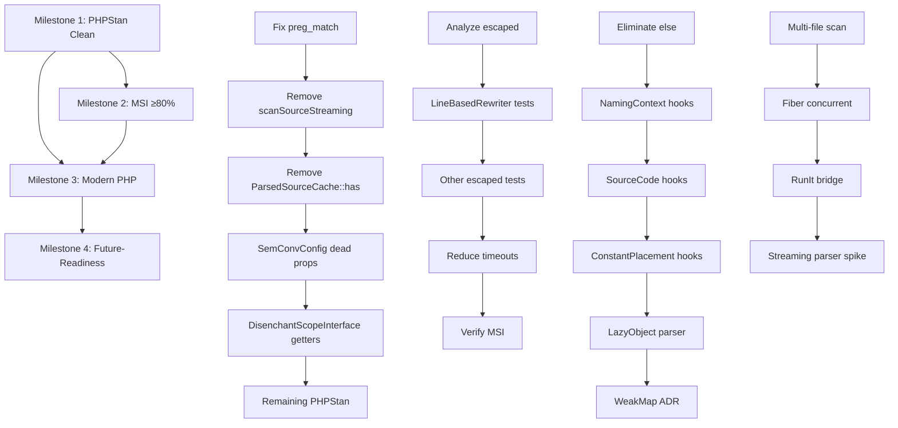

# DisenchantIt Refactoring Plan

**Based on:** `docs/REVIEW.md` (2026-10-10)  
**Status:** DRAFT — Ready for implementation  
**Target:** PHP 8.4+, maintain hexagonal architecture, achieve ≥80% MSI

---

## Overview

This plan organizes the review findings into four milestones with discrete, verifiable tasks. Each task includes:
- **Objective** — what changes
- **Files affected** — precise locations
- **Acceptance criteria** — how to verify completion
- **Risk** — LOW/MEDIUM/HIGH
- **Estimated effort** — S (small), M (medium), L (large)

---

## Milestone 1: Code Quality Gates — PHPStan Clean (Immediate)

**Goal:** Zero PHPStan errors at level `max`  
**Timeline:** 1–2 days  
**Blockers:** None

### Task 1.1: Fix `preg_match` Argument Count False Positives
- **Objective:** Suppress PHPStan false positives on optional `preg_match` parameters
- **Files:**
  - `src/Adapter/Detection/ContentClassifier.php` (lines 46, 62, 73, 78)
  - `src/Adapter/Detection/NamingContextExtractor.php` (line 117)
  - `src/Adapter/Grouping/ClosedSetDetector.php` (line 23)
  - `src/Adapter/Reporting/SarifRecorder.php` (lines 20, 23, 32, 63, 70, 71)
  - `src/Adapter/SemConv/FileSemConvStore.php` (line 43)
- **Action:** Add `#[ReturnTypeWillChange]` attribute or `@phpstan-ignore` with justification comment
- **Acceptance:** `vendor/bin/phpstan analyse` shows 0 errors for these lines
- **Risk:** LOW
- **Effort:** S

### Task 1.2: Remove Unused Method `Detector::scanSourceStreaming()`
- **Objective:** Delete dead code flagged by PHPStan
- **Files:**
  - `src/Adapter/Detection/Detector.php` (lines 110–124)
  - `src/Contract/Detection/StringLiteralDetectorInterface.php` (remove method signature)
- **Action:** Remove method and interface declaration; it's marked "convenience wrapper" and unused
- **Acceptance:** PHPStan no longer reports unused method; tests pass
- **Risk:** LOW (method is public but unused in codebase)
- **Effort:** S

### Task 1.3: Remove Unused `ParsedSourceCache::has()` Method
- **Objective:** Delete dead code
- **Files:**
  - `src/Adapter/Detection/ParsedSourceCache.php` (lines 42–45)
  - `src/Contract/Detection/ParsedSourceCacheInterface.php` (remove method signature)
- **Action:** Remove method and interface declaration
- **Acceptance:** PHPStan clean; tests pass
- **Risk:** LOW
- **Effort:** S

### Task 1.4: Address `SemConvConfig` Unused Properties
- **Objective:** Remove or implement dead properties
- **Files:** `src/ValueObject/SemConv/SemConvConfig.php`
- **Dead properties:** `outputPath`, `outputPathOverride`, `interfaceName`, `DOT`, `PHP_FILE_EXTENSION`
- **Action:** 
  - Option A: Remove if truly unused (verify via `grep -r` across codebase)
  - Option B: Implement getter for `outputPath` property hook (already has virtual getter)
- **Acceptance:** PHPStan no longer reports unused properties
- **Risk:** LOW
- **Effort:** S

### Task 1.5: Address `DisenchantScopeInterface` Unused Getters
- **Objective:** Remove or implement namespace filter getters
- **Files:**
  - `src/ValueObject/Scope/DisenchantScopeInterface.php` (lines 38–46)
  - `src/ValueObject/Scope/DisenchantScope.php` (corresponding methods)
- **Action:** Since namespace filtering is "deferred — not yet enforced" (per docblock), remove from interface and implementation; add back when implemented
- **Acceptance:** PHPStan clean; no breaking changes (methods not called anywhere)
- **Risk:** LOW
- **Effort:** S

### Task 1.6: Fix Remaining PHPStan Errors (Vendor Types, etc.)
- **Objective:** Clean up remaining 100+ errors (mostly unused code from interface methods not implemented)
- **Files:** Various adapters implementing interfaces partially
- **Action:** For each interface method not needed by an adapter:
  - Add empty implementation throwing `BadMethodCallException` with "not supported" message, OR
  - Split interface into smaller focused interfaces (preferred per ISP)
- **Acceptance:** `vendor/bin/phpstan analyse` exits 0
- **Risk:** MEDIUM (may require interface redesign)
- **Effort:** M

---

## Milestone 2: Mutation Testing — Achieve ≥80% MSI (Short-term)

**Goal:** Infection MSI ≥80% with 0 timeouts  
**Timeline:** 3–5 days  
**Blockers:** Milestone 1 complete (clean PHPStan helps mutation)

### Task 2.1: Analyze Escaped Mutants
- **Objective:** Catalog all 17 escaped mutants with location and type
- **Files:** `infection.log`, `infection.summary.json`
- **Action:** Run `vendor/bin/infection --min-msi=0 --show-mutations` and categorize:
  - `LineBasedRewriter` ternary/conditionals (priority)
  - `Detector::scanSourceStreaming` (remove per Task 1.2)
  - Others
- **Acceptance:** Documented list of escaped mutants with file:line and mutation type
- **Risk:** LOW
- **Effort:** S

### Task 2.2: Add Tests for `LineBasedRewriter` Escaped Mutants
- **Objective:** Kill mutants in ternary operators and loop conditions
- **Files:**
  - `src/Adapter/Rewriting/LineBasedRewriter.php` (lines ~145, 257, 324, 339, 353)
  - `tests/Unit/LineBasedRewriterTest.php` (extend)
- **Mutants to target:**
  - `enumAlreadyExists` ternary (line 145)
  - `findExistingConstantNames` loop condition (line 257)
  - `findClassBodyBraces` loop condition (line 324)
  - `findClassOpeningBraceLine` ternary (line 339)
  - `findClassClosingBraceLine` ternary (line 353)
- **Action:** Add test cases covering:
  - Enum already exists (true/false branches)
  - Class with no existing constants
  - Class not found in source
  - Single-line class declarations
  - Nested braces edge cases
- **Acceptance:** All 5+ mutants killed; MSI improves
- **Risk:** LOW
- **Effort:** M

### Task 2.3: Add Tests for Other Escaped Mutants
- **Objective:** Cover remaining escaped mutants across codebase
- **Files:** Various adapters per Task 2.1 analysis
- **Action:** For each escaped mutant, add targeted test case exercising the mutated branch
- **Acceptance:** All 17 escaped mutants killed
- **Risk:** LOW
- **Effort:** M

### Task 2.4: Reduce Mutation Timeouts
- **Objective:** Eliminate 47 timed-out mutants
- **Files:** `infection.json5` config
- **Action:**
  - Increase timeout: `"timeout": 300` (seconds per mutant)
  - Enable parallel: `"threads": 4` (or CPU count)
  - Consider `--skip-not-covered` if some mutants in uncovered code
- **Acceptance:** 0 timeouts in infection run
- **Risk:** LOW
- **Effort:** S

### Task 2.5: Verify MSI ≥80%
- **Objective:** Confirm target achieved
- **Action:** Run `vendor/bin/infection --min-msi=80 --threads=4`
- **Acceptance:** Command exits 0; summary shows MSI ≥80%
- **Risk:** LOW
- **Effort:** S

---

## Milestone 3: Modern PHP Features & Code Hygiene (Medium-term)

**Goal:** Adopt property hooks, LazyObject, eliminate `else`; improve maintainability  
**Timeline:** 1–2 weeks  
**Blockers:** Milestones 1–2 complete

### Task 3.1: Eliminate `else` in `FlagSetTarget`
- **Objective:** Refactor to early-return pattern
- **Files:** `src/Adapter/Rewriting/FlagSetTarget.php` (line 146)
- **Current:**
  ```php
  if ($variable === null) {
      $variable = $ctx->variableName;
  } elseif ($variable !== $ctx->variableName) {
      return null;
  }
  ```
- **Refactored:**
  ```php
  if ($variable === null) {
      $variable = $ctx->variableName;
      continue;
  }
  if ($variable !== $ctx->variableName) {
      return null;
  }
  ```
- **Acceptance:** `tools/order_check.php` passes; no `else`/`elseif` in codebase; tests pass
- **Risk:** LOW
- **Effort:** S

### Task 3.2: Add Property Hooks to `NamingContext`
- **Objective:** Replace `hasHint()` method with virtual property
- **Files:**
  - `src/ValueObject/Source/NamingContext.php`
  - `src/ValueObject/Source/NamingContextInterface.php`
- **Current:** Method `hasHint(): bool` checks `variableName !== null || comment !== null || unit !== null`
- **Refactored:** Virtual property `public bool $hasHint { get => ... }`
- **Acceptance:** Interface declares `public bool $hasHint { get; }`; implementation uses hook; all callers updated
- **Risk:** LOW
- **Effort:** S

### Task 3.3: Add Property Hooks to `SourceCode`
- **Objective:** Make `identity()` a virtual property
- **Files:**
  - `src/ValueObject/Source/SourceCode.php`
  - `src/ValueObject/Source/SourceCodeInterface.php`
- **Current:** Method `identity(): string` returns `hash('xxh3', $this->code)`
- **Refactored:** Virtual property `public string $identity { get => hash('xxh3', $this->code); }`
- **Acceptance:** Interface declares property hook; all callers use `$code->identity` (property access)
- **Risk:** LOW
- **Effort:** S

### Task 3.4: Add Property Hooks to `ConstantPlacement`
- **Objective:** Derived accessors for computed values
- **Files:**
  - `src/ValueObject/Rewrite/ConstantPlacement.php`
  - `src/ValueObject/Rewrite/ConstantPlacementInterface.php`
- **Candidates:** Any computed/derived values (review class for methods that could be hooks)
- **Acceptance:** Relevant methods converted to property hooks; interface updated
- **Risk:** LOW
- **Effort:** S

### Task 3.5: Replace Manual Lazy Parser with `LazyObject`
- **Objective:** Use PHP 8.4 `LazyObject` for parser instantiation
- **Files:** `src/Adapter/Detection/Detector.php`
- **Current:** Manual `private ?object $parser = null;` with lazy init in `scanSource()`
- **Refactored:**
  ```php
  use LazyObject;
  
  private LazyObject $parser;
  
  public function __construct(
      // ... existing deps
      private ParserFactoryInterface $parsers,
  ) {
      $this->parser = new LazyObject(
          static fn () => $this->parsers->build(),
      );
  }
  
  // In scanSource():
  $parser = $this->parser->getValue();
  ```
- **Acceptance:** Parser instantiated on first access only; tests pass; PHPStan clean
- **Risk:** MEDIUM (new PHP 8.4 feature, verify compatibility)
- **Effort:** M

### Task 3.6: Add `WeakMap` for AST Cache (Optional Enhancement)
- **Objective:** If object-identity caching becomes needed, use `WeakMap`
- **Files:** `src/Adapter/Detection/ParsedSourceCache.php`
- **Current:** Array keyed by content hash (`SourceCode::identity()`)
- **Note:** Review confirmed content-keyed is correct; `WeakMap` not needed now. Document decision in ADR.
- **Action:** Add ADR-0012 documenting why `WeakMap` not used
- **Acceptance:** ADR created; no code change needed
- **Risk:** LOW
- **Effort:** S

---

## Milestone 4: Architecture & Future-Readiness (Long-term)

**Goal:** Prepare for multi-file scanning, Fibers, RunIt integration  
**Timeline:** 2–4 weeks (ongoing)  
**Blockers:** Milestones 1–3 complete

### Task 4.1: Create Multi-File Scanning Entry Point
- **Objective:** Add `scanDirectory()` or similar to `DisenchanterInterface`
- **Files:**
  - `src/Contract/DisenchanterInterface.php`
  - `src/Core/Disenchanter.php`
  - `src/Factory/DisenchanterFactory.php`
- **Design:** Accept `Iterator<string>` of file paths or `Traversable<SourceCode>`; return aggregated results
- **Acceptance:** Can scan multiple files in one call; reuses parser/cache; tests pass
- **Risk:** MEDIUM
- **Effort:** M

### Task 4.2: Implement Fiber-Based Concurrent Scanning
- **Objective:** Overlap I/O (file read) and parsing using Fibers
- **Files:** New `src/Adapter/Detection/ConcurrentDetector.php` (implements `StringLiteralDetectorInterface`)
- **Design:**
  - Fiber per file: read → parse → traverse → yield results
  - Shared parser pool (or parser per fiber)
  - Bounded concurrency (e.g., `maxFibers = CPU count`)
- **Acceptance:** Benchmark shows >1.5× speedup on 100+ files; memory bounded
- **Risk:** HIGH (new concurrency model)
- **Effort:** L

### Task 4.3: RunIt Bridge Package Preparation
- **Objective:** Prepare for `it-pack/run-it-disenchant-it` bridge (per ADR-0005)
- **Files:** New package or `src/Bridge/RunIt/`
- **Design:**
  - Map `DisenchantContext` → `RunIt\Execution`
  - Map `DisenchantOccurrence` → `RunIt\Occurrence`
  - Map `DisenchantSnapshot` → `RunIt\Snapshot`
  - No `ItPack\RunIt\*` imports in `Core` (enforced by phparkitect)
- **Acceptance:** Bridge package compiles; `forbidSibling` rule passes
- **Risk:** MEDIUM
- **Effort:** M

### Task 4.4: Streaming Parser Research Spike
- **Objective:** Evaluate true incremental parsing (streaming lexer)
- **Files:** Spike branch / document
- **Action:** Research `nikic/php-parser` streaming capabilities or alternative lexers; document feasibility
- **Acceptance:** Decision recorded in ADR-0013: proceed / defer / not feasible
- **Risk:** LOW (spike only)
- **Effort:** M

---

## Cross-Cutting Tasks (Run Throughout)

### Task X.1: Update Documentation Per Change
- **Trigger:** Every task that changes public API or behavior
- **Files:** `README.md`, `USER_GUIDE.md`, `docs/architecture/decisions/ADR-*.md`
- **Action:** Update examples, add new ADRs for architectural decisions
- **Acceptance:** Docs reflect current code; no stale examples

### Task X.2: Run Quality Gate After Each Task
- **Command:** `composer quality` (cs:check → analyse → architecture → test → mutation → security:audit)
- **Acceptance:** All checks pass before marking task complete

### Task X.3: Add Regression Tests for Fixed Bugs
- **Trigger:** Any bug fix during refactoring
- **Action:** Add test case that would have caught the bug
- **Acceptance:** Test fails before fix, passes after

---

## Dependency Graph



---

## Success Criteria Summary

| Metric | Current | Target | Milestone |
|--------|---------|--------|-----------|
| PHPStan errors | 132 | 0 | M1 |
| Mutation MSI | ~61% | ≥80% | M2 |
| Mutation timeouts | 47 | 0 | M2 |
| `else`/`elseif` count | 1 | 0 | M3 |
| Property hooks usage | 1 | ≥4 | M3 |
| LazyObject adoption | 0 | 1 | M3 |
| Multi-file scanning | No | Yes | M4 |
| Fiber concurrency | No | Yes | M4 |

---

## Rollback Plan

If any task breaks `composer quality`:
1. Revert commit(s) for that task
2. Document blocker in task notes
3. Escalate for design review
4. Proceed with independent tasks

---

## Notes

- **ADR Updates:** Tasks 1.2, 1.3, 1.5, 3.6, 4.3, 4.4 require new/updated ADRs
- **Versioning:** Target `1.0.0` after Milestone 2; breaking changes allowed before
- **CI Integration:** All milestones must pass in `.github/workflows/quality.yml` matrix (PHP 8.4/8.5)
- **Performance Baselines:** Capture before/after for Tasks 3.5, 4.2

---

*Generated from `docs/REVIEW.md` — implement tasks in order, verify quality gate at each step.*