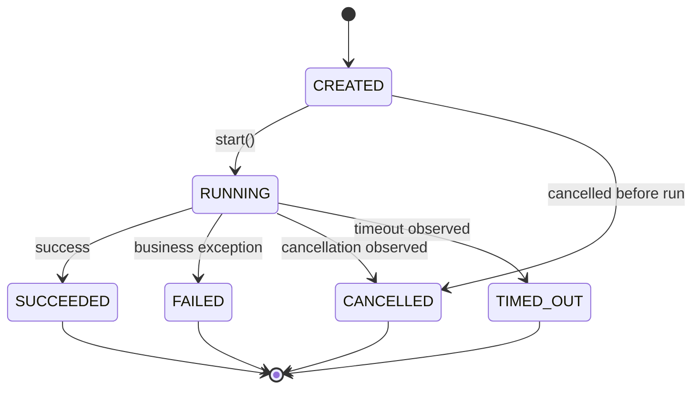
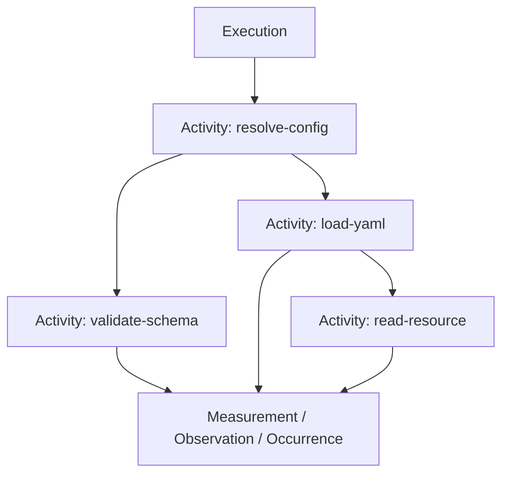

# RunIt Execution Lifecycle

The execution lifecycle is the runtime state machine that governs how an
execution moves from creation to a single terminal outcome. It is implemented in
the application layer and coordinated by `ExecutionLifecycleCoordinator`; the
domain `Execution` record is an immutable artifact that never mutates in place.

## State machine

```text
CREATED
   │
   ▼
RUNNING
   ├──► SUCCEEDED
   ├──► FAILED
   ├──► CANCELLED
   └──► TIMED_OUT
```



A terminal state cannot transition again. Repeating the same terminal completion
is idempotent; a *different* terminal completion raises
`ConflictingCompletionException`.

- `created → running` is performed by the runner through
  `ExecutionLifecycleCoordinator::start()` immediately before the consumer
  operation is invoked. `Execution::create()` produces the `created` record; the
  coordinator transitions it to `running`.
- `created → cancelled` is permitted (a created execution may be cancelled before
  it runs) and is validated by the same transition matrix.
- `running → succeeded | failed | cancelled | timed_out` are the only legal
  terminal transitions.
- A terminal execution cannot transition again. Repeating the same terminal
  completion is idempotent (the coordinator returns the record unchanged), while
  completing a terminal execution with a *different* terminal status raises
  `ConflictingCompletionException`.
- Any other transition raises `InvalidLifecycleTransitionException`.

The closed matrix lives in `ExecutionLifecycleCoordinator::ALLOWED`; the pure
companion `ExecutionLifecycleCoordinator::isAllowed()` reasons about the matrix
without completing an execution.

## Runner flow

For an execution, `DefaultExecutionRunner::run()` performs the following. It
attempts to detach the scope in a `finally` block; a detach failure is reported
and contained, but restoration cannot be guaranteed if storage fails:

1. Resolve the nested-execution policy (`NestedExecutionPolicyInterface`) for the
   current ambient execution and the new definition.
2. Create the `created` execution, transition it to `running`, and attach its
   scope to context storage.
3. Attempt to publish the running execution, then invoke the consumer operation.
4. On success: resolve open activities, transition to `succeeded` (or `failed`
   under the explicit fail-on-open policy), and publish the completed execution
   and a terminal `execution` snapshot.
5. On failure: resolve open activities, attempt to record a failure observation,
   transition `running → failed`, publish the completed execution and a terminal
   snapshot, and rethrow the original `Throwable`.

Terminal execution publication is attempted before creating the terminal
snapshot. A snapshot factory failure is reported through the runner's health path
without suppressing the earlier execution publication attempt; an error
escaping execution publication prevents the snapshot attempt. Under the default
`FailOpenPolicy`, an inner publisher error is swallowed and does not prevent
the snapshot attempt. These guarantees concern attempts, not successful
delivery by a failing publisher; snapshot provenance checks can also prevent
snapshot publication. A failed terminal transition prevents both terminal
publication attempts.

The runner uses `FailSafeArtifactPublisher` with `FailOpenPolicy`. An omitted or
null `onPublicationFailure` selects the PHP error log; a no-op closure opts out
of this runner health path. Callback and fallback failures are contained on the
runner's reporting paths, but error-log delivery is best effort. These protections
do not guarantee restoration or a terminal artifact when other collaborators fail.
See [self-instrumentation](self-instrumentation.md) for diagnostic limitations.

## Nested execution

Nested calls to the runner are resolved into exactly one
`NestedExecutionMode` (`child_execution`, `activity_only`, `detached_execution`,
`reject_nested`) by the configured policy. The default policy is
`ChildExecutionPolicy`, which links the nested execution to its parent. See
`NestedExecutionPolicyInterface` and the policy implementations in
`Application\Policy`.

## Activity nesting

Activities form an explicit parent/child tree expressed by identity
(`parentActivityId()`), not an in-memory collection. Each nested activity inherits
the active context and reports through the same recorders; open activities are
resolved by the completion policy when the execution finishes. Depth is bounded by
the configured activity-depth limit.

Currently `AutoFailOpenActivitiesPolicy` records a critical observation for each
open activity; its message says auto-resolved, but the policy itself does not close
it. With the default runner, `FailExecutionOnOpenActivitiesPolicy` also records
critical observations and marks an otherwise successful execution failed if any
activities remain open, even if recording the diagnostic fails. Its fixed
`open_activity_policy` failure-description class is a synthetic marker, not a
thrown exception, and contains no activity data or trace. Custom runners must
implement this outcome themselves. Neither policy closes activities or changes
the business result or original exception.



## Exception preservation

A failed execution records the original `Throwable` through
`ThrowableMapperInterface`, which captures only a safe, bounded description
(class, truncated message, optional cause chain, optional stack trace). The
runner normally rethrows the exact original `Throwable`; the mapped description is
carried on the failed execution artifact, never in place of the business
exception. Unprotected collaborator failures, including provenance cleanup in the
runner's `finally` block, can still interrupt that outcome.

## Cancellation and timeout

Cancellation and timeout are modelled by `Cancellation` and `Timeout` value
objects and mapped through `CancellationMapperInterface` / `TimeoutMapperInterface`.
RunIt records consumer-defined cancellation causes but does **not** forcibly
interrupt arbitrary PHP code: cancellation and timeout are observed and recorded,
not preemptive control-flow mechanisms.

## Vocabulary

- `run-it#Execution` — root aggregate and lifecycle subject.
- `run-it#ExecutionStatus` — the lifecycle status vocabulary.

See `docs/EXECUTION.md` for the canonical execution model and `vocab/run-it.ttl`
for the OWL vocabulary.
