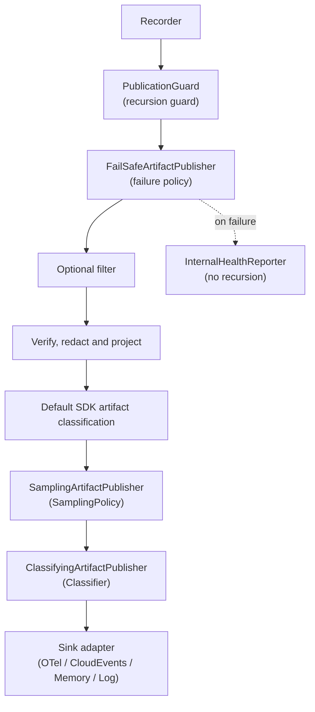

# Artifact Publication Pipeline

RunIt emits immutable artifacts (observations, occurrences, measurements, and snapshots)
through a single port, `ArtifactPublisherInterface::publish(ExecutionArtifactInterface)`.
Adapters decide what "emitting" means: an in-memory buffer, a log line, an OpenTelemetry
export, or nothing. The **publication pipeline** sits between recorders and adapters and
composes small, single-purpose publishers so emission stays secure, bounded, and
failure-aware without coupling the domain to any transport.

The pipeline is built from decorators that all implement `ArtifactPublisherInterface` and
wrap an inner publisher. Because every stage shares the same contract, stages compose in
any order and are independently testable.

## Ordering

The pipeline stages are composed outside-in:

```
guard → fail-safe → filter → verify/redact/project → strict classification → sample → classify → buffer → sink
```

Redaction runs before sampling, but it is not a complete allowlist. In the default
SDK composition, executions, activities, observations, occurrences and snapshots
receive additional classification before sampling, and unclassified measurements
are reported and dropped. SDK builder custom and null redactors also pass through
these classifiers, and ordinary and health-aware custom stacks receive classified
projections. The SDK invokes a custom redactor once and passes null as the factory's
redactor argument. This is a compatibility change for custom stack factories.
The later generic classifier bounds projections, but bounding alone does not prove
that retained content is safe. The default standalone factory creates an unshared
authority when none is supplied, so unverifiable artifacts are reported and dropped
before the redactor, sampler and sink. Arbitrary custom composition can bypass this
boundary and must not be treated as safe without independent controls.



| Stage                  | Contract / class                                                  | Responsibility                                                                                                               |
|------------------------|-------------------------------------------------------------------|------------------------------------------------------------------------------------------------------------------------------|
| Guard                  | `PublicationGuard`, `GuardedArtifactPublisher`                    | Prevents recursive publication on one execution path.                                                                        |
| Fail-safe              | `FailSafeArtifactPublisher` + `PublicationFailurePolicyInterface` | Applies the failure policy when the inner publisher throws.                                                                  |
| Redact                 | `RedactingArtifactPublisher` + `RedactorInterface`                | Masks configured sensitive fields before sampling; concrete types visible.                                                   |
| Default classification | Internal default-SDK classifiers                                  | Classifies lifecycle artifacts, observations, occurrences and snapshots and drops unclassified measurements before sampling. |
| Sample                 | `SamplingArtifactPublisher` + `SamplingPolicyInterface`           | Drops artifacts the sampling policy rejects. Not a security boundary.                                                        |
| Classify               | `ClassifyingArtifactPublisher`                                    | Projects artifacts to bounded, type-safe fields before the sink.                                                             |
| Sink                   | any `ArtifactPublisherInterface` adapter                          | The real transport (in-memory, log, OpenTelemetry, ...).                                                                     |

Filtering runs first by design: a dropped artifact never reaches redaction, sampling,
buffering, or the adapter, so volume costs are paid as late as possible.

### Activity-context rejection

The runtime-local activity-context implementation has an opt-in strict policy that
rejects recordings with missing or mismatched execution context before publication
and snapshot persistence, by payload-free drop and report by default or by an
explicitly configured throw. Recorders must still honor their return contracts on a
drop; a returned artifact is not evidence that it was persisted, published, or
exported. The default policy instead records at execution level without an activity
edge. An attached matching execution with no active activity is ordinary
execution-level recording, not a strict rejection.

Trusted activity relationships require verified handles bound to the exact owning
execution scope; legacy activity IDs alone are untrusted claims. Verification of
an artifact does not by itself prove a correct activity relationship, and neither
verification nor dispatch guarantees delivery. Existing provenance cleanup and
fail-closed behavior for retained raw work remain in force; this design adds no
ownership lease. Overlapping activities retain independent attribution in both
completion orders (`OverlappingActivityProvenanceTest` passes); the concurrency
guarantee is complete.

## Redaction happens before external publication

`RedactingArtifactPublisher` forwards the result of `RedactorInterface::redact()`.
The default redactor returns the original instance when nothing matches and a generic
`RedactedArtifact` projection otherwise; it does not mutate the original. Its current
throwable masking covers a top-level `throwable` and a failed execution's
`result.throwable`, including recognized previous causes. By default it masks
messages and replaces recognized traces with null. Occurrence data and snapshot payload
masking only covers configured key names, and the default lists are empty.
Unknown artifact fields and unsupported shapes are not necessarily masked;
generic projections may not retain typed sampling interfaces. These limitations are
tracked in Phase 2; do not treat this pipeline as a complete security boundary for
arbitrary artifact contents.

## Failure policies

`FailSafeArtifactPublisher` catches the original adapter exception and hands it to a
`PublicationFailurePolicyInterface`:

- **FailOpenPolicy** — swallows the error (default). Publication must never replace the
  operation's business result or business exception.
- **FailClosedPolicy** — rethrows the *original* adapter error unchanged.
- **CollectAndContinuePolicy** — forwards the error and artifact to a collector.
- **ReportToFallbackPolicy** — republishes the artifact to a separate fallback publisher;
  a fallback failure is caught and routed to the health reporter instead of recursing.

## Buffering and backpressure

An individually oversized artifact or an artifact offered to a zero-item-capacity
buffer is reported and rejected before the interval flush check. Even when the
interval has elapsed, retained entries remain buffered
until a later operation triggers a flush or the caller explicitly flushes or closes.
Ordinary non-throwing overflow handling instead reaches the interval check.

During `close()`, draining removes each entry and deducts its estimate before
calling the inner publisher. If that call throws, the same exception propagates;
the attempted entry is not retried or counted as a buffer drop, and remaining
entries stay buffered in FIFO order. Remainder dropping and the flush observer
are not reached on that failed call. A later `close()` starts a new shutdown
budget and drains the survivors; even an empty repeated close notifies the
observer with a zero count. These are current semantics, not a delivery guarantee:
the inner publisher may have performed side effects before throwing.

### Provenance lifetime and asynchronous delivery

Each SDK build creates its own in-process provenance authority. The execution
runner owns its records: it releases them after terminal publication and context
detachment, and also releases issued records on setup failure. Release removes
the execution's records and their relationship edges, including edges to other
executions. Evidence is attached to the exact artifact object through a weak map;
retaining an artifact does not keep its released records valid. There is no
completion acknowledgement, lease, or time-based expiry for outstanding
publication work. The authority is documented for a single persistent worker;
the implementation does not establish thread-safe concurrent access.

With the SDK builder's default stack, provenance verification and export-ID
projection happen synchronously, followed by sampling and classification before
the configured base publisher is called. A buffer used as that base therefore
receives the classified projection while the records are live; later delivery of
that projection does not need the authority. This does not guarantee delivery.
Buffer limits, expiry, and failures still apply. A default standalone
`PublicationPipeline` is not connected to the SDK authority and drops artifacts
it cannot verify; a custom stack may behave differently.

Custom stack factories receive classified export projections through the SDK's
ownership boundary, not original attested artifacts or business IDs. In
`RunItBuilder::build()`, the composed publisher from a custom stack factory is
wrapped by the SDK's `PublisherStackFactory` with classification, sampling,
provenance verification, and redaction layers before delivery. The custom stack
therefore sees artifacts that have already been classified and projected by the
SDK, and the configured redactor runs only once on the outermost layer. Buffering
inside a custom stack operates on these classified projections; later delivery of
a buffered projection does not need the authority, and provenance verification
has already occurred before the custom stack receives the artifact. This does not
guarantee delivery. Buffer limits, expiry, and failures still apply.

The authority caps records both per execution and across the SDK instance
(100,000 each by default), and caps relationship edges across the authority
(200,000 by default). Rejected issuance or relationships are reported and lack
trusted provenance. These capacity bounds are not asynchronous lifetime management:
the current runner does not retain records until queued raw work completes or
expires. Supporting that behavior requires an ownership and completion/expiry
protocol, including concurrency and overflow semantics; the current publisher
port provides no such acknowledgement.

`BufferedArtifactPublisher` checks both the projected item count and estimated byte
total before admission, including after waiting or eviction. An item larger than the
entire byte limit is reported and rejected immediately without evicting other items;
`Fail` throws, while the other strategies drop it. Zero item capacity admits nothing;
zero byte capacity permits zero-estimated items subject to the item limit. Negative
configuration values and negative buffer estimates throw `InvalidArgumentException`.
The default estimator still returns zero if JSON encoding fails, and estimates are not
actual process-memory measurements. When an item does not fit, the configured
`OverflowStrategy` decides what to drop:

- **DropNewest** — discard the incoming artifact.
- **DropOldest** — discard oldest buffered artifacts until the incoming item fits.
- **DropLowPriority** — discard a low-priority artifact (high-priority = error observations
  and terminal snapshots win); a high-priority incoming item may require multiple evictions.
- **BlockWithTimeout** — wait briefly for space, then drop newest.
- **Fail** — throw `BufferOverflowException` so the surrounding failure policy decides.

An entry expires only when its age exceeds `maxAgeSeconds`; an entry exactly at
the boundary remains eligible for publication. Expired entries are removed and
reported without consuming the successful-publication batch budget.
If their health reporter throws, the removed entry is already counted as dropped
and deducted from the estimate; the exception interrupts the flush and its
observer, while later entries remain available for a retry.
`flush()` emits at most `batchSize` non-expired artifacts; `close()` flushes within
`shutdownFlushBudget` and drops whatever remains. Dropped and expired artifacts are
reported to the internal health reporter so loss stays observable without re-entering the
guarded pipeline.

A throwing health reporter can interrupt an eviction before the replacement is
appended; standalone exceptions propagate. Buffered item accounting is updated before
the report. The configured pipeline failure policy governs exceptions raised within it.
During draining, an item is removed and its estimate deducted before the sink is called.
If the sink throws, that attempted item is not retried by the buffer; later items remain
buffered, and the exception propagates to the caller or surrounding failure policy.
The drop counter does not count this failed sink attempt.
During close, a throwing drop reporter interrupts removal of the remaining items;
the item being reported has already been removed and counted as dropped. A later
close can process the remaining items. Flush observers run after the batch is drained,
so an observer exception propagates after those deliveries and does not undo them.

## Recursion prevention

`PublicationGuard` tracks an active-depth counter. `GuardedArtifactPublisher` enters the
guard before publishing and leaves it in a `finally`, so the guard can never be left open
after a failure. If publication is already active when `enter()` is called, the guard
throws `RecursivePublicationException`, which the guarded publisher catches and routes to
the `InternalHealthReporterInterface` (for example `CallbackHealthReporter` or
`ErrorLogHealthReporter`) instead of publishing again. Health reporters must never call
the guarded publisher, so self-observation (an exporter that records its own export) and
fallback reporting can never loop.

## Custom composition

`PublicationPipeline` accepts its dependencies in its constructor, including an
optional stack factory. Its filter runs before the default verification boundary
and therefore receives the original artifact. A custom factory controls its own
ordering and must independently enforce any required provenance and classification
before sampling, buffering or delivery. Redaction and size bounds alone do not
prove that arbitrary content is safe.
