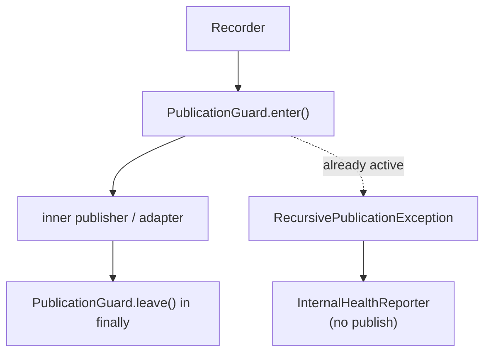

# RunIt Self-Instrumentation

RunIt should use its own execution model to describe its own operation, but it must
never recursively observe the act of publication. This page describes the guard
rails that keep self-instrumentation safe and the intended (uninstrumented) path for
bootstrap and hot code.

## The recursion problem

An adapter exporter is itself an activity that could be recorded as a RunIt
execution. If recording that activity publishes through the same pipeline, the
exporter would observe its own export, which would observe its own observation, and
so on. The same loop appears in fallback reporting: a fallback publisher that fails
must not re-enter the guarded pipeline.

## Recursion guard

`PublicationGuard` tracks an active-depth counter. `GuardedArtifactPublisher`
enters the guard before publishing and leaves it in a `finally`, so the guard can
never be left open after a failure. If publication is already active when `enter()`
is called, the guard throws `RecursivePublicationException`, which the guarded
publisher catches and routes to the `InternalHealthReporterInterface` instead of
publishing again.

Health reporters (`CallbackHealthReporter`, `ErrorLogHealthReporter`) implement
`InternalHealthReporterInterface`. They should not call the guarded publisher:
`GuardedArtifactPublisher` routes nested publication to the reporter again on
re-entry and can recurse without bound if the reporter feeds the same pipeline;
`FailSafeArtifactPublisher` suppresses nested publication without invoking the
reporter again, falling back to a payload-free diagnostic instead. The
instance-wide guard does not isolate interleaved calls.

## Guard in the default stack

The builder-composed stack (the one every consumer gets by default) carries its own
reentrancy protection: `FailSafeArtifactPublisher` tracks an active publish depth and
routes any nested publish to the health reporter as a
`RecursivePublicationException` instead of executing it, unless the reporter is
already active, in which case the nested report is suppressed. The explicit
`GuardedArtifactPublisher` remains available through `PublicationPipeline` for
composed pipelines; the fail-safe guard guarantees the property holds even in the
simple default wiring.

## Health callbacks are contained

Health callbacks are userland code, so they may throw. `CallbackHealthReporter`
passes the original failure and artifact to the configured callback. If it throws,
the fallback log receives fixed diagnostics without exception messages or artifact
identifiers, and the artifact is not normalized. If writing that fallback throws,
it attempts a separate fixed system-log notice. A failure of that last
resort is contained, although PHP's system log can fail without reporting it.
Other invocation sites have separate failure paths and are not covered by this
guarantee. Runner setup failures are passed to its callback, or to the default PHP
error log when the callback is null, after any setup cleanup. The runner contains
failures from that reporting path; however, a cleanup failure before reporting can
still escape. Its guarded `reportFailure()` path uses fixed, payload-free fallback
diagnostics for reporter failures and suppressed recursive reports. Neither path
guarantees log delivery. Guards are per instance and can suppress interleaved
independent reports; they do not provide concurrency isolation.

## Instrument batches, not every method

Instrumentation is applied at the exporter boundary — batches and flushes — rather
than around every internal method. An OpenTelemetry or CloudEvents exporter records
its own export as a single operational activity per batch, not per artifact, which
keeps the self-instrumentation cost flat and avoids re-entering the pipeline on the
hot path.

## Intentionally uninstrumented bootstrap path

The bootstrap and wiring path that builds the engine, the pipeline, and the
publishers is kept uninstrumented on purpose. Constructing the recorder stack must
not itself require a running execution, so there is no circular dependency between
"starting an execution" and "having a publisher". The runner attaches the execution
scope only once the consumer operation is about to run.

## Dogfooding without recursion

When RunIt models its own quality gates (test execution, static analysis,
architecture analysis, mutation testing, benchmarks, release validation — see
M14.6), each is represented as a normal execution through the same ports. The
guard blocks nested delivery on the same publisher, but a health callback that
republishes can repeatedly invoke itself. Benchmark effects require measurement.
See [`lifecycle.md`](lifecycle.md) and [`publication.md`](publication.md).

## What is guarded

- Recursive publication on one execution path → `RecursivePublicationException` →
  health reporter.
- Fallback publisher failure → health reporter, never re-published.
- Self-observation (exporter records its own export) → single batched activity, no
  loop.

## Vocabulary

- `run-it#Execution` — even RunIt's own operation is an execution.

See [`publication.md`](publication.md), [`security.md`](security.md), and `AGENTS.md`
(Self-Instrumentation).
